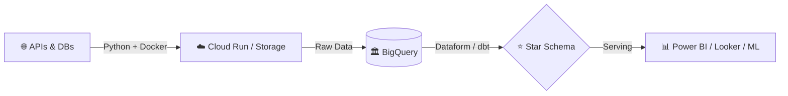

<div align="center">

  <!-- Typing SVG Header -->
  <a href="https://git.io/typing-svg">
    
  </a>

  <!-- Badges de contacto discretos -->
  <p align="center">
    <a href="https://www.linkedin.com/in/yesid-jurado/">
      
    </a>
    <a href="https://github.com/yesidexe">
      
    </a>
    
    
  </p>

</div>

---

### ⚙️ `config.yml`

```yaml
engineer:
  name: "Yesid"
  role: "Data & Analytics Engineer"
  background: "Systems Engineering & Software Development"
  focus:
    - "Serverless ETL/ELT Pipelines"
    - "Dimensional Modeling (Star Schema)"
    - "API Data Ingestion & Automation"

radar_2026:
  daily_stack: ["Python", "SQL", "BigQuery", "Dataform", "Cloud Run", "Docker"]
  exploring: ["dbt Core", "S3 / MinIO", "PySpark", "FastAPI"]
  reading: "Fundamentals of Data Engineering — Reis & Housley"
```

---

### 🧰 Stack técnico

<div align="center">
  <!-- Stack principal -->
  <p>
    
  </p>

  <!-- Servicios de datos & BI -->
  <p>
    
    
    
    
    
  </p>
</div>

---

### 🔄 Flujo habitual de trabajo



---

<div align="center">
  <sub>⚡ <i>"Raw data is just noise until it's modeled, tested, and served."</i></sub>
</div>
